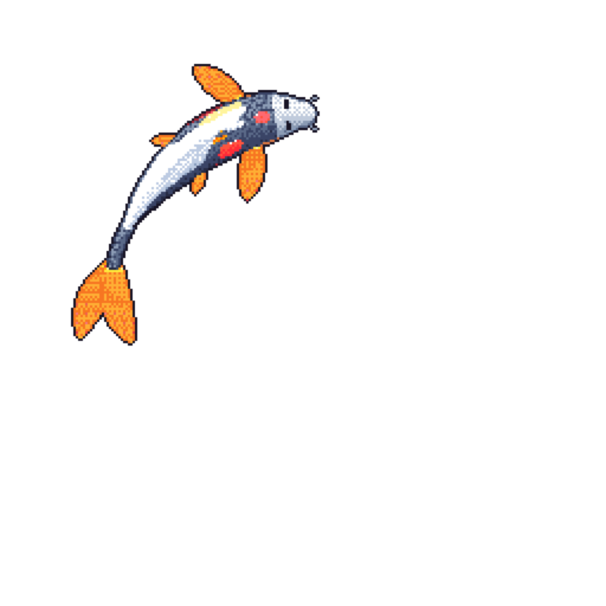

 

 

<table>
<tr>
<td valign="top">

### About

- 🔭 Working on Computer Vision & Data Science
- 🌱 Currently exploring AI and Data Science
- 🎓 Second-year B.Tech CSE (AI & ML) at Centurion University of Technology and Management, CGPA 8.67/10
- 💼 Experience: AI & ML Intern at E&ICT Academy, IIT Guwahati (Remote), July 2026 – September 2026. Worked on deep learning applications, Visual Question Answering (VQA), video captioning, and developed and submitted an Image Captioning project.
- 🏅 Microsoft Certified: Azure AI Fundamentals (AI-901)
- 📫 Reach me: [mrtej117@gmail.com](mailto:mrtej117@gmail.com)

</td>
</tr>
</table>

### Tech Stack

<b>Microsoft Azure</b>

  

<b>Languages & OS</b>

<b>AI / Deep Learning</b>

 

<b>Data Science</b>

 

<b>Big Data</b>

 

<b>Cloud & AI</b>

<b>Databases & Tools</b>

 

## Featured Projects

| Project | Highlights |
|---|---|
| [Vision2Text](https://github.com/mrtej117/vision2text-image-captioning) | Image Captioning, CNN-LSTM; ResNet-50 encoder + LSTM decoder, MS COCO 2017, BLEU-1 69.85%, BLEU-4 27.40% |
| [ASCII Depth Rain](https://github.com/mrtej117/ASCII-Depth-Human) | Real-Time Computer Vision; MediaPipe segmentation + OpenCV, Matrix-style ASCII rain from webcam |
| [Customer Churn Prediction using PySpark](https://github.com/mrtej117/pyspark-customer-churn-analysis) | 7,043 records, Spark MLlib Decision Tree, ROC-AUC 0.7789 |

## GitHub Stats

  

  

## Tej's Fish

 
<b>🐟 Tej's Fish</b> redrawn from GitHub activity

  

## Resume

  

<b>SAI TEJ N.V</b>

